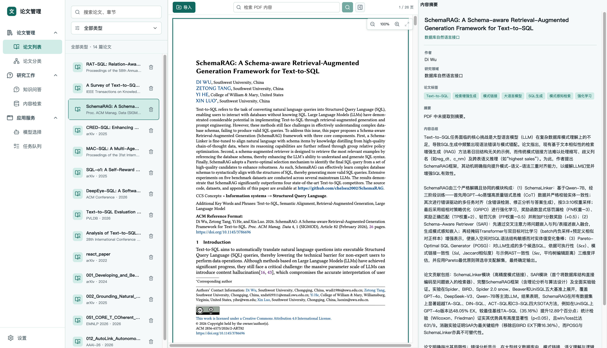
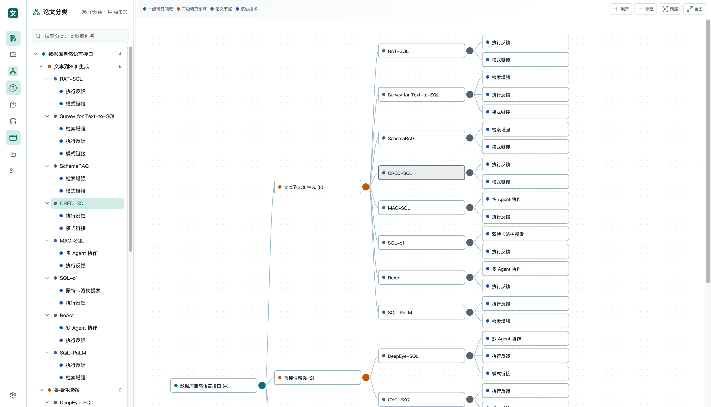
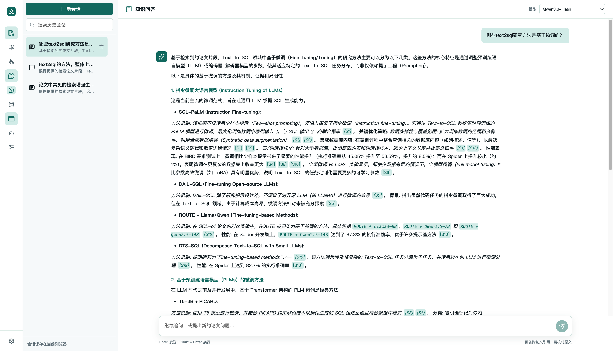
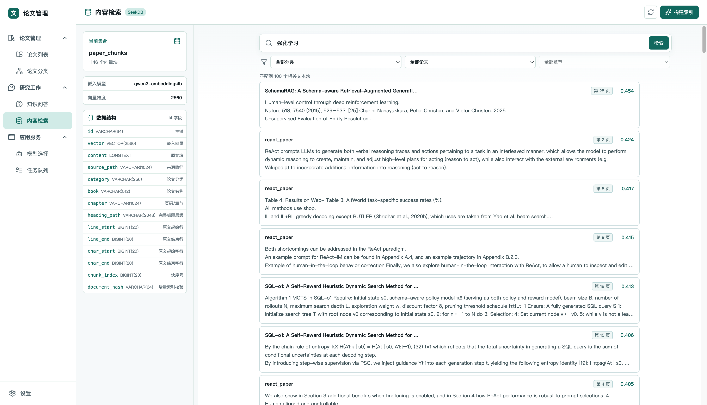
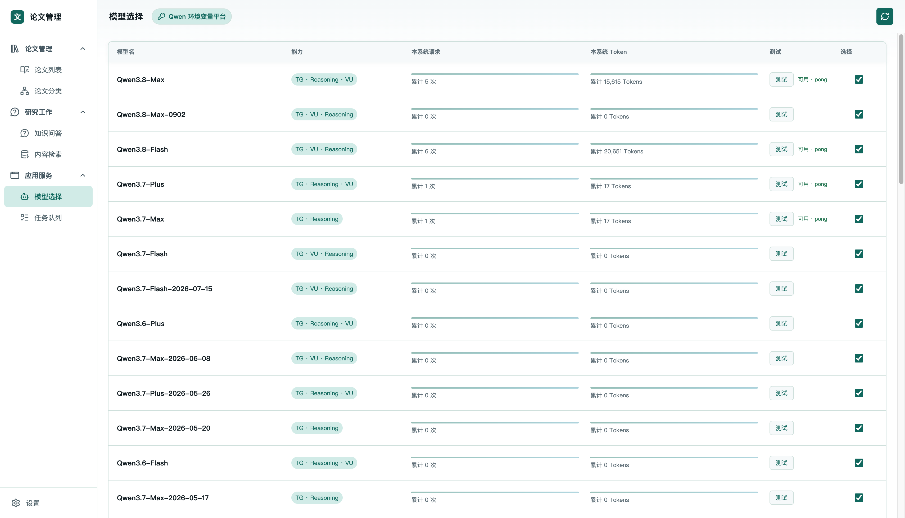
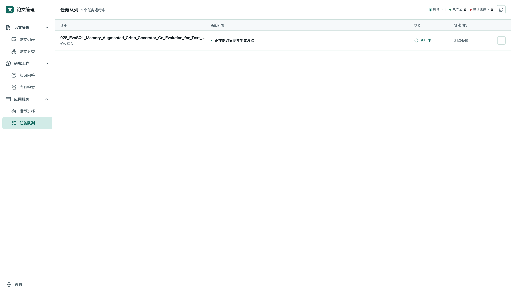

# PaperBox

PaperBox 是一个面向研究论文的本地管理与知识问答系统。它将 PDF 论文解析为可追溯的文本块，建立向量索引与论文级上下文，并提供分类浏览、语义检索、带引用的问答和任务管理能力。

> 默认数据、上传论文、向量索引、PowerContext 上下文和会话记录均保存在本地 `data/` 目录，不会提交到 Git。

## 功能概览

### 论文管理

- 导入 PDF 后在后台完成文本提取、元数据识别、摘要与内容总结、向量入库和 PowerContext 捕获，不阻塞后续导入。
- **内容总结**：导入阶段调用 LLM 对论文进行结构化精读，总结研究目的与动机、方法设计、关键模块与处理步骤、主要贡献、实验设计与效果，以及适用边界或局限。总结展示在论文内容摘要中，帮助在阅读全文前快速粗读论文；原文未说明的信息会明确标注，避免将推断当作论文结论。
- 论文列表提供 PDF 阅读、页码进度、缩放、关键词定位、内容摘要、删除确认和任务状态展示。
- 使用 LLM 基于论文摘要、关键词和内容总结构建“一级研究领域 -> 二级研究领域 -> 论文节点 -> 核心技术”分类图；同一论文可关联多个核心技术。
- 分类图支持展开/收起、拖拽浏览、滚轮缩放和双击查看论文详情。

#### 论文列表



#### 论文分类



### 研究工作

- **知识问答**：使用 SeekDB 召回相关的论文文本块；为命中论文补充摘要，并通过 PowerContext 组织论文级辅助上下文。回答附带可追溯的片段引用。
- **内容检索**：按语义相似度搜索论文块，显示论文标题、页码、相似度和高亮片段，可查看对应文本位置。

#### 知识问答



#### 内容检索



### 应用服务

- **模型选择**：从配置的 Qwen/DashScope 平台读取模型列表，在本地持久化启用模型与用量统计。
- **任务队列**：展示论文导入与索引的阶段、状态和错误信息，并支持停止尚未完成的任务。

#### 模型选择



#### 任务队列



## 架构与数据流

```text
PDF 导入
  -> pypdf 提取与清洗文本
  -> Qwen 生成题名、摘要、标签、内容总结和分类信息
     （目的动机、方法设计、模块步骤、实验效果、局限）
  -> Ollama 生成嵌入向量
  -> SeekDB 保存可引用文本块和向量索引
  -> PowerContext 保存论文级 Source / Memory
```

| 组件 | 作用 | 是否需要单独部署 |
| --- | --- | --- |
| FastAPI | PDF 导入、论文管理、向量检索、任务接口 | 否，随后端启动 |
| Vite + React | 前端界面与模型 API 代理 | 否，开发模式随 `npm run dev` 启动 |
| SeekDB | 本地嵌入式向量数据库，数据位于 `data/vector/seekdb/` | 否，后端进程内打开 |
| PowerContext | 论文级上下文管理，SQLite 数据位于 `data/powercontext/` | 否，作为后端子应用运行 |
| Ollama | 文本嵌入服务 | 是，需要本机或可访问的 Ollama 服务 |
| Qwen / DashScope | 论文元数据生成、分类与知识问答 | 是，需要可用 API 地址和密钥 |

## 环境要求

- Linux、macOS 或 Windows WSL
- Conda 或 Miniconda
- Python 3.12（推荐）
- Node.js 20 LTS 或更高版本
- npm 10 或更高版本
- [Ollama](https://ollama.com/)：默认使用 `qwen3-embedding:4b`
- 可访问的 Qwen/DashScope 原生 API；默认配置指向阿里云 DashScope

建议先确认工具可用：

```bash
conda --version
python --version
node --version
npm --version
ollama --version
```

## 安装与配置

### 1. 创建 Python 环境

项目没有维护 `environment.yml`，请按以下方式创建名为 `paper` 的环境。根目录脚本默认使用该环境名。

```bash
conda create -n paper python=3.12 -y
conda activate paper
pip install -r requirements.txt
```

### 2. 安装前端依赖

```bash
npm --prefix src/frontend install
```

### 3. 准备 Ollama 嵌入服务

在另一个终端启动 Ollama，并拉取默认嵌入模型：

```bash
ollama serve
ollama pull qwen3-embedding:4b
```

若 Ollama 部署在其他地址，可在 `.env` 中设置 `OLLAMA_HOST`；使用其他嵌入模型时设置 `OLLAMA_EMBED_MODEL`。修改嵌入模型后，必须重建论文向量索引。

### 4. 配置 Qwen/DashScope

从模板创建本地配置文件：

```bash
cp .env.example .env
```

编辑 `.env`，至少设置密钥：

```dotenv
# Qwen / DashScope native API endpoint
LLM_URL=https://dashscope.aliyuncs.com/api/v1
LLM_API_KEY=your_api_key

# 默认 Ollama 嵌入服务，可按实际部署覆盖
OLLAMA_HOST=http://127.0.0.1:11434
OLLAMA_EMBED_MODEL=qwen3-embedding:4b

# 可选：本地持久化目录
SEEKDB_DIR=data/vector/seekdb
SEEKDB_TABLE=paper_chunks
POWERCONTEXT_DIR=data/powercontext
```

未配置有效 LLM 时，界面仍可启动，但论文自动总结、分类、模型选择和知识问答无法使用。

## 启动服务

在项目根目录执行：

```bash
conda activate paper
npm run dev
```

该命令会先启动仅监听本地的 FastAPI 后端，再启动 Vite 前端：

| 服务 | 默认地址 | 说明 |
| --- | --- | --- |
| 后端 API | `http://127.0.0.1:9200` | 健康检查：`/healthz` |
| 前端 | `http://localhost:9100` | 若 9100 被占用，Vite 会自动选择下一个端口并打印地址 |

前端会代理 `/api` 到本地后端。若后端端口 `9200` 已被占用，先停止已有服务或单独修改启动命令的端口；根目录开发脚本会在后端启动失败时停止全部子进程。

也可分别启动：

```bash
# 终端一：后端，支持热重载
npm run dev:backend

# 终端二：前端
npm --prefix src/frontend run dev
```

生产式后端启动命令：

```bash
npm run start
```

该命令只启动后端。若需要完整的本地论文处理能力，可配合此前端开发服务使用。

## Qoder Site 静态演示发布

当前前端可直接作为无后端演示站点发布。构建产物内置 10 篇论文的元数据、摘要、内容总结与分类；内容检索在浏览器中进行关键词排序，知识问答返回基于命中片段组织的预设回答。模型选择、任务队列和会话也只使用浏览器本地状态。

这个模式不会读取 `.env`、不会请求 Ollama、Qwen、SeekDB 或 PowerContext，也不会上传用户选择的 PDF。导入 PDF 仅用于当前标签页的本地预览；刷新页面后自动移除。

在项目根目录构建：

```bash
npm --prefix src/frontend run build
```

随后将 `src/frontend/dist/` 上传到 Qoder Site。若使用 CLI，进入前端目录后执行：

```bash
cd src/frontend
sites deploy dist
```

静态演示不需要配置反向代理、数据库、模型密钥或 Python 环境。

## 首次使用与数据维护

1. 打开前端，在“模型选择”中刷新并勾选可用的文本模型。
2. 在“论文列表”点击“导入”，选择带文本层的 PDF。
3. 在“任务队列”观察解析、LLM 总结、向量写入和 PowerContext 捕获进度。
4. 导入完成后，可直接进行内容检索、知识问答和论文分类浏览。

扫描版 PDF 若没有可提取文本，需要先完成 OCR；当前导入流程不会自动进行 OCR。

### 重建已有论文索引

文本分块策略或嵌入模型变更后，重建 PDF 的 SeekDB 与 PowerContext 数据：

```bash
npm run papers:reindex

# 仅处理路径中含有指定文字的一篇论文
npm run papers:reindex -- --only react_paper
```

### 重新归并论文分类

当已有多篇论文且希望按全体摘要、关键词和内容总结重新归并分类时：

```bash
npm run papers:reclassify
```
